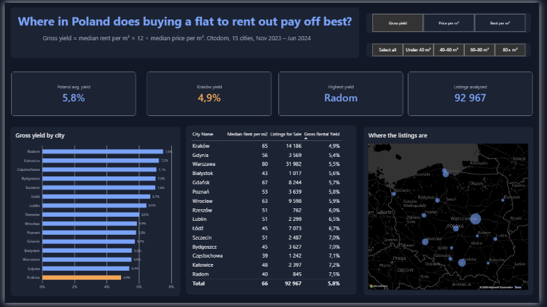
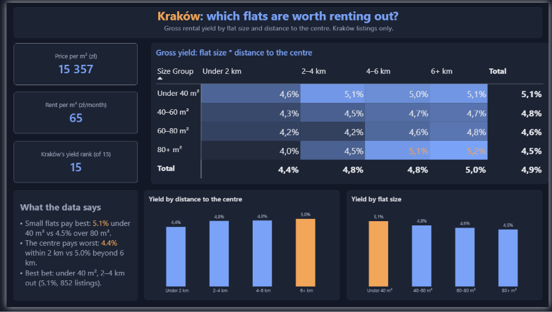
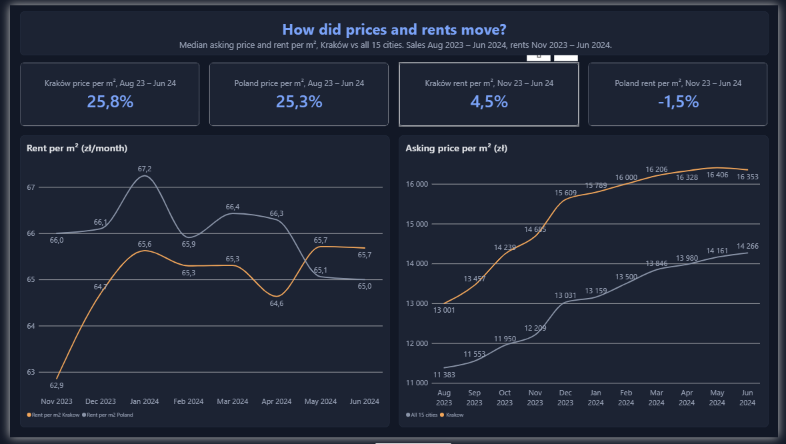

# Where in Poland does buying a flat to rent out pay off? | Power BI

**Kraków is the worst of 15 big Polish cities for buying a flat to rent out. Its gross rental yield is 4.9%, the average for all 15 cities is 5.8%, and Radom tops the list with 7.5%. Inside Kraków, small flats away from the centre do best (5.1%), and large flats in the centre do worst (4.0%).**

I live in Kraków and kept hearing that buying a flat here is "the safest investment". I wanted to check how it compares with other cities when you look at rent, not only at price.

## Data

| | |
|---|---|
| Source | [Apartment Prices in Poland](https://www.kaggle.com/datasets/krzysztofjamroz/apartment-prices-in-poland), Kaggle (Otodom listings) |
| Sale listings | 11 monthly files, Aug 2023 – Jun 2024, 195,568 rows, 92,967 unique listings |
| Rent listings | 8 monthly files, Nov 2023 – Jun 2024, 70,847 rows |
| Cities | 15 |

Each monthly file is a snapshot of active listings, so the same flat often appears in several months. I count listings by their unique ID.

## How yield is calculated

Gross rental yield = median rent per m² × 12 ÷ median asking price per m²

Rent data starts only in November 2023, while sale data starts in August. My first version mixed the two periods, and Kraków came out at 5.1%. Now the price side is calculated only for the months that have rent data (DAX `TREATAS`), and Kraków dropped to 4.9%.

## What I did

1. Power Query: loaded all monthly CSV files from one folder, took the month from each file name, set data types (the Polish locale read decimals as text, so I switched the file to en-US).
2. Data model: star schema with two fact tables (Sales, Rent) and four dimension tables (City, Calendar, Size Groups, Distance Groups). The group tables filter sales and rent at the same time, which is needed to calculate yield for each group.
3. DAX measures: medians, gross yield, best city, Kraków's rank among 15 cities, month-over-month and period change.
4. Report: three pages, Poland overview, Kraków deep dive and price trends, in one dark theme that I built as a JSON file. Orange always marks Kraków or the group the text talks about.

## How to use the report

- The metric buttons (Gross yield / Price per m² / Rent per m²) switch the city chart to another measure. I built them with a field parameter, and the chart title changes with the button.
- The flat size buttons recalculate the whole first page for one size group, for example only flats under 40 m².
- When you hover over a city on the chart or the map, a card shows its yield, price, rent and rank. The card is a hidden tooltip page.

## Key findings

**1. Cheaper cities give the best yield.** Rent doesn't fall as fast as price. A square metre in Radom costs 6,326 zł and rents for 40 zł a month. In Warsaw it costs 16,900 zł and rents for 80 zł, so twice the rent for 2.7 times the price.

| City | Median price per m² (zł) | Median rent per m² (zł/month) | Gross yield |
|---|---:|---:|---:|
| Radom | 6,326 | 40 | 7.5% |
| Katowice | 7,886 | 48 | 7.2% |
| Częstochowa | 6,392 | 39 | 7.1% |
| Warszawa | 16,900 | 80 | 5.5% |
| Kraków | 15,357 | 65 | 4.9% |
| All 15 cities | 12,979 | 66 | 5.8% |

**2. For small flats Kraków is no longer last.** With the size filter set to flats under 40 m² (18,640 listings), the average for all cities is 5.4% and Kraków gets 5.1%, 14th of 15. Gdynia is last with 4.9%, and Częstochowa leads with 8.3%.

**3. In Kraków, smaller flats further from the centre pay off better.**

| Flat size | Under 2 km | 2–4 km | 4–6 km | 6+ km |
|---|---:|---:|---:|---:|
| Under 40 m² | 4.6% | 5.1% | 5.0% | 5.1% |
| 40–60 m² | 4.3% | 4.5% | 4.7% | 4.8% |
| 60–80 m² | 4.2% | 4.2% | 4.6% | 4.8% |
| 80+ m² | 4.0% | 4.5% | 5.1% | 5.2% |

The best mix with enough data is a flat under 40 m², 2–4 km from the centre: 5.1% on 852 rent listings. The 5.2% for 80+ m² beyond 6 km is based on only 37 rent listings, so I don't rely on it.

**4. Prices are growing faster than rents.**

From August 2023 to June 2024 the median asking price per m² rose 25.8% in Kraków and 25.3% across all 15 cities. In Kraków most of the rise happened by December (13,001 → 15,609 zł), and since February the price has stayed at about 16,000–16,400 zł. Rents moved much less between November 2023 and June 2024: +4.5% in Kraków and −1.5% across all cities. Over those same months the Kraków price per m² went up about 11%, so the yield keeps getting smaller.

The price jump happened at the same time as the government's 2% mortgage programme (Bezpieczny Kredyt 2%) in the second half of 2023. This data alone can't prove the programme caused it.

## What this means for a buyer

If the goal is rental income, Kraków is a weak choice: you pay one of the highest prices in Poland for a rent that is close to the national level. Radom, Katowice, Częstochowa and Bydgoszcz return more per złoty invested. If you buy in Kraków anyway, a small flat outside the very centre is the better bet.

## Files

- `Poland_Apartments_.pbix`: the Power BI report (3 pages and a hidden tooltip page)
- `images/`: screenshots of each page

## Limitations

- These are asking prices from listings, not real transaction prices. Final prices are usually lower.
- Gross yield ignores costs: taxes, building fees, repairs and months without a tenant. Net yield would be lower everywhere.
- The "all 15 cities" figures are medians of all listings together, so Warsaw, with about a third of the listings, has the biggest weight.
- Some size and distance groups in Kraków have few rent listings (see finding 3).
- The data ends in June 2024. The market may look different now.

**Tools:** Power BI Desktop (Power Query, DAX, star schema, field parameters, report page tooltips, custom JSON theme, map, matrix with conditional formatting)
